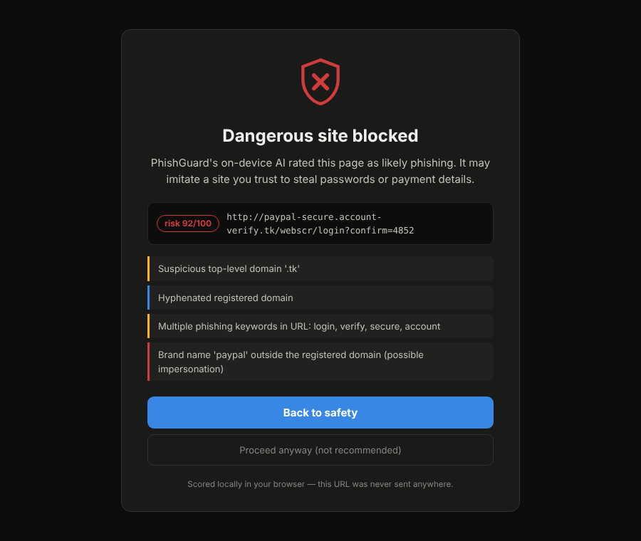
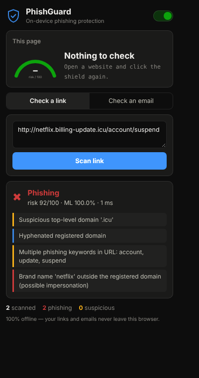
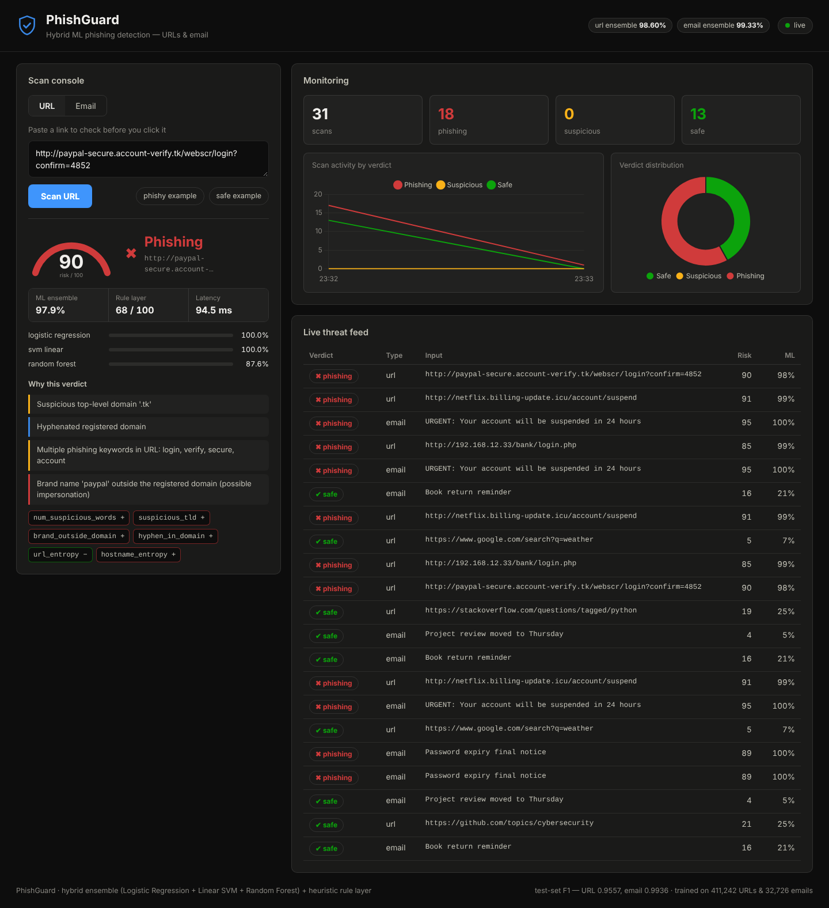
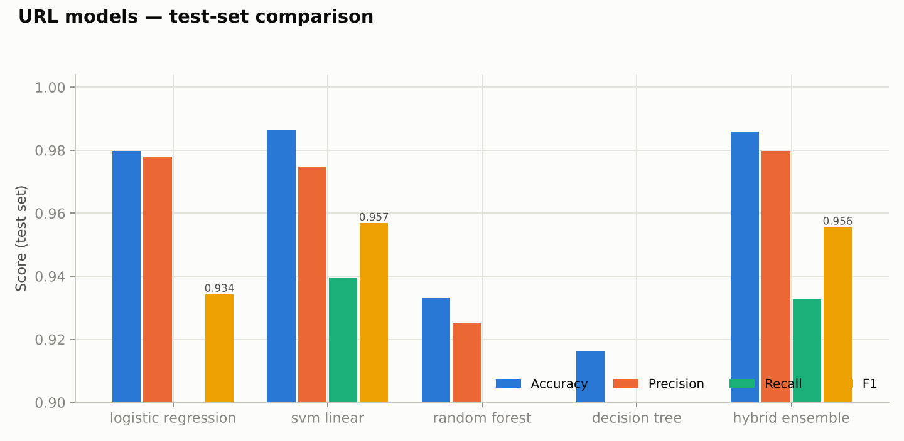
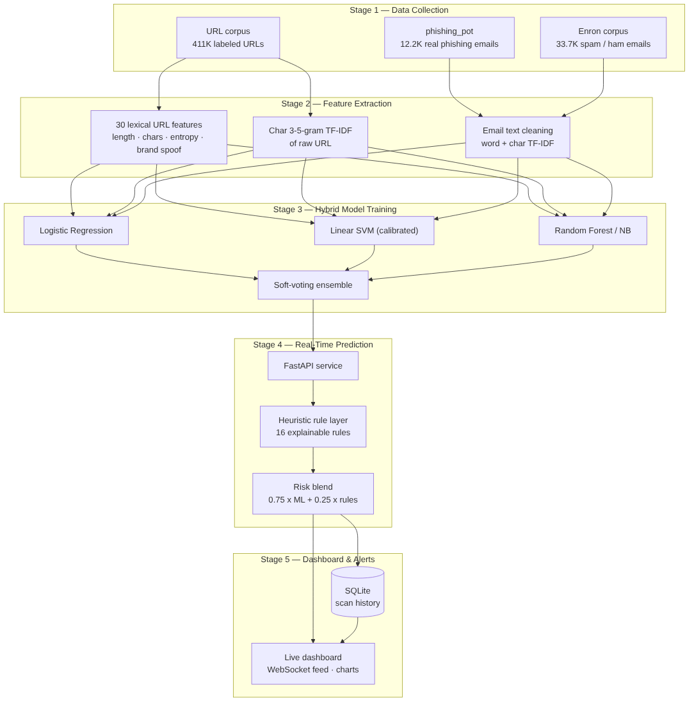

# PhishGuard 🛡️

**AI-Powered Phishing Detection System for URLs & Emails with a Real-Time Dashboard**

PhishGuard detects phishing *before the click*. A hybrid machine-learning
ensemble (Logistic Regression + Linear SVM + Random Forest / Naive Bayes,
combined by soft voting) analyses both **URL structure** and **email
content**, blends the result with an explainable **heuristic rule layer**,
and ships two ways:

| 🧩 [Browser extension](extension/) — for everyone | 📊 Dashboard + API — for security teams |
|---|---|
| The full detector compiled to 2.7 MB of JSON, scoring in ~1 ms of JavaScript. Blocks phishing pages behind a warning, flags dangerous links on pages, scans pasted emails. **100% offline — no URL ever leaves your browser.** | FastAPI service with the complete ensemble, SQLite scan history, WebSocket live feed, and a real-time monitoring console with explainable verdicts. |

<p align="center">
  
  
</p>



## Highlights

| | |
|---|---|
| 🧩 **Real product, not a demo** | Chrome/Edge/Brave extension with fully on-device ML — install it and it protects you today |
| 🔒 **Private by architecture** | the extension makes zero network requests; there is nothing to leak |
| 🔀 **Hybrid ensemble** | 4 classifier families per channel, soft-voting final verdict (per Karim et al., IEEE Access 2023) |
| 🌐 **Dual channel** | one unified system for URLs *and* emails |
| ⚡ **Real-time** | in-memory scoring in ~1–40 ms, WebSocket push to every open dashboard |
| 🔍 **Explainable** | per-model probabilities, 16 human-readable heuristic rules, top TF-IDF tokens per verdict |
| 📊 **Live dashboard** | risk dial, evidence panel, verdict tiles, activity timeline, live threat feed |
| 🧪 **Tested** | pytest suite over features, heuristics and the API |
| 📦 **Reproducible** | one-command data download + training; Dockerfile included |

## Results (held-out test sets)

| Detector | Dataset | Accuracy | Precision | Recall | F1 | ROC-AUC |
|---|---|---|---|---|---|---|
| **URL hybrid ensemble** | 411,242 URLs | **0.9860** | 0.9797 | 0.9329 | **0.9557** | 0.9960 |
| **Email hybrid ensemble** | 32,726 emails | **0.9933** | 0.9939 | 0.9933 | **0.9936** | 0.9996 |

The weighted ensemble posts the **highest precision of any model on URLs**
(≈20% fewer false positives than the strongest single model at matching
accuracy) and matches the best member's F1 in both channels, while
protecting against any single model's failure modes — full per-model
tables, confusion matrices, ROC curves and feature importances are in
[`results/`](results/) and [`docs/REPORT.md`](docs/REPORT.md).



On-device extension models (exported + re-evaluated on the same held-out
sets): URL **98.49%** acc / F1 0.9522 · email **99.30%** acc / F1 0.9933 —
see `results/extension_metrics.json` and the JS↔Python parity test
(`node extension/tests/parity_test.mjs`, agreement ≈ 1e-6).

## Quick start

**Protect yourself (30 seconds, nothing to install but the extension):**
open `chrome://extensions` → Developer mode → **Load unpacked** → select
the [`extension/`](extension/) folder. Full guide: [extension/README.md](extension/README.md).

**Run the full server + dashboard:**

```bash
git clone https://github.com/shivakumar-07/PhishGuard.git
cd PhishGuard
pip install -r requirements.txt

# 1) download public datasets (~90 MB + a git clone of real phishing emails)
python setup_data.py

# 2) prepare data and train both hybrid ensembles (CPU, ~30–45 min)
python phishguard/training/prepare_data.py
python phishguard/training/train_url.py
python phishguard/training/train_email.py

# 3) launch the dashboard
uvicorn phishguard.api.main:app --port 8000
```

Open **http://localhost:8000** — scan a URL or an email, watch the verdict
dial, the evidence panel and the live feed. API docs: http://localhost:8000/docs

> Trained models are included in [`models/`](models/), so steps 1–2 are
> optional if you just want to run the dashboard.

For a lively demo, stream scripted scans at the dashboard:

```bash
python scripts/demo_requests.py
```

## How it works



1. **Data collection** — 411K labelled URLs; 12.2K *real* phishing emails
   (phishing_pot) + Enron ham/spam corpus.
2. **Feature extraction** — 30 lexical URL features (entropy, brand-spoof
   check, IP-host, `@` trick, …) + char 3–5-gram TF-IDF; word+char TF-IDF
   for emails with volatile tokens generalised.
3. **Hybrid training** — LR, calibrated Linear SVM, RF/NB and a DT
   baseline; validation-weighted soft-voting ensemble; full evaluation
   suite.
4. **Real-time prediction** — `risk = 0.75·ML + 0.25·rules`, three-band
   verdict (safe / suspicious / phishing), trusted-domain allowlist.
5. **Dashboard & alerts** — FastAPI + SQLite + WebSocket live feed +
   Chart.js (vendored, works offline).

Details: [`docs/ARCHITECTURE.md`](docs/ARCHITECTURE.md) ·
Project report: [`docs/REPORT.md`](docs/REPORT.md) ·
Viva prep: [`docs/VIVA_QA.md`](docs/VIVA_QA.md)

## API

```bash
curl -X POST http://localhost:8000/api/scan/url \
     -H "Content-Type: application/json" \
     -d '{"url": "http://paypal-secure.account-verify.tk/login"}'
```

```json
{
  "verdict": "phishing",
  "risk_score": 92.4,
  "ml_probability": 0.97,
  "heuristic_score": 78.0,
  "per_model": {"logistic_regression": 0.98, "svm_linear": 0.99, "random_forest": 0.94},
  "reasons": [{"rule": "Brand name 'paypal' outside the registered domain …", "severity": "high"}],
  "top_tokens": [{"token": "verify", "direction": "phishing"}]
}
```

| Endpoint | Purpose |
|---|---|
| `POST /api/scan/url` | score a URL |
| `POST /api/scan/email` | score an email (subject/body/sender) |
| `GET /api/scans` | scan history |
| `GET /api/stats` | aggregates for the dashboard |
| `GET /api/model-info` | training metrics & thresholds |
| `WS /ws/live` | live verdict stream |

## Tests

```bash
python -m pytest tests/ -v
```

## Datasets & credits

* URL corpus — [faizann24/Using-machine-learning-to-detect-malicious-URLs](https://github.com/faizann24/Using-machine-learning-to-detect-malicious-URLs)
* Real phishing emails — [rf-peixoto/phishing_pot](https://github.com/rf-peixoto/phishing_pot) (CC-BY-4.0)
* Enron spam/ham — [MWiechmann/enron_spam_data](https://github.com/MWiechmann/enron_spam_data)
* Reference: A. Karim et al., *"Phishing Detection System Through Hybrid
  Machine Learning Based on URL"*, IEEE Access, 2023.

## License

MIT — see [LICENSE](LICENSE).
